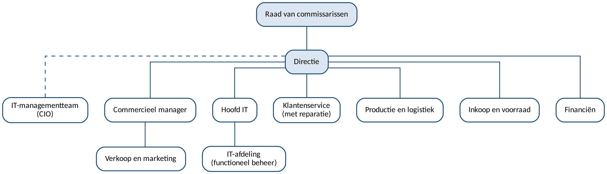

[← Terug naar de inhoudsopgave](README.md)

# 2. Organisatorische context

In dit hoofdstuk beschrijven wij de omgeving waarin de app wordt gebouwd. De basis komt uit ons bedrijfsplan, onze BPM Lifecycle en onze pakketselectie.

## 2.1 Missie, visie, kernwaarden en strategie

| Onderdeel | Watch My Watch |
|---|---|
| **Missie** – waarom bestaan wij? | Wij helpen mensen om gezonder en bewuster te leven, met wearables die passen bij hun eigen doelen. |
| **Visie** – wat willen wij worden? | Een wearable is geen afstandelijke technologie, maar een digitale partner die met de klant meegroeit. |
| **Kernwaarden** – waar geloven wij in? | Persoonlijk: wij kennen onze klant en zijn doelen. Betrouwbaar: onze producten meten goed en wij gaan zorgvuldig om met gegevens. Samen groeien: wij blijven de klant begeleiden, ook na de aankoop. |
| **Strategie** – hoe maken wij de visie waar? | Customer intimacy (Treacy & Wiersema, 1993). Wij willen niet de goedkoopste zijn en ook niet altijd de eerste met nieuwe techniek. Wij willen onze klanten beter kennen dan de concurrent en ze persoonlijk begeleiden. |

Voor de app betekent customer intimacy drie dingen. Ten eerste moet de app de klant kennen: welke apparaten hij heeft, wat zijn doelen zijn en welke vragen hij eerder stelde. Ten tweede moet de app persoonlijk advies geven, en niet voor iedereen hetzelfde. Daarom kiezen wij de AI-coach als unieke functionaliteit (zie 5.3). Ten derde mag de klant nooit het gevoel hebben dat hij alleen staat. Lukt het niet met de chatbot, dan is er een medewerker die de hele geschiedenis van de klant ziet.

## 2.2 Doelstellingen

Wij verwachten dat de eerste versie van de app op 1 maart 2028 live gaat, na de invoering van Odoo. De doelen hieronder gelden een jaar daarna. De getallen zijn schattingen. Na de eerste drie maanden meten wij de echte startwaarden in Power BI en stellen wij de doelen zo nodig bij.

| Doelstelling | Meetbaar met | Doel | Klaar op |
|---|---|---|---|
| Klanten gebruiken de app regelmatig. | Het aandeel klanten met een geregistreerd apparaat dat de app minstens één keer per maand opent | Minstens 40 procent | 1 maart 2029 |
| Klanten lossen vragen zelf op in de app. | Het aandeel vragen dat in de app wordt opgelost zonder medewerker (chatbot, handleiding of controle op het apparaat) | Minstens 30 procent | 1 maart 2029 |
| Klanten zijn tevreden over de hulp bij een melding. | Het gemiddelde cijfer dat de klant geeft na het sluiten van een melding | Minstens een 8 | 1 maart 2029 |
| Klanten blijven bij ons kopen. | Het aandeel app-gebruikers dat binnen een jaar een accessoire, onderdeel of abonnement koopt via de app | Minstens 15 procent | 1 maart 2029 |

De afhandeltijd van een melding staat niet in deze tabel. Die is al een doel uit onze BPM Lifecycle: maximaal 24 uur vanaf 1 mei 2027. De app moet ervoor zorgen dat wij die norm blijven halen, ook als er meer meldingen binnenkomen.

## 2.3 Bedrijfscultuur

Wij beschrijven onze cultuur met de vijf dimensies van Hofstede (Hofstede et al., 2010).

| Dimensie | Watch My Watch | Uitleg |
|---|---|---|
| Kleine of grote machtsafstand | Kleine machtsafstand | Medewerkers mogen meedenken en de leidinggevende is makkelijk te bereiken. Bij de invoering van Odoo zit er bijvoorbeeld een key user van elke afdeling in het project. Voor de app doen wij hetzelfde: klantenservice test mee. |
| Individualistisch of collectivistisch | Collectivistisch | Wij werken als één team voor de klant. Een probleem bij de klant is niet het probleem van één afdeling. Daarom kijken wij naar processen van begin tot eind, en niet per afdeling. |
| Masculien of feminien | Feminien | Zorg voor de klant en samenwerking staan bij ons voorop, niet winnen ten koste van anderen. Dat past bij een bedrijf dat mensen helpt om gezonder te leven. |
| Lage of hoge onzekerheidsvermijding | Hoge onzekerheidsvermijding | Bij gezondheidsgegevens en de kwaliteit van onze producten willen wij vaste regels. Daarom is de kwaliteitscontrole verplicht en leggen wij privacyregels vast. Bij nieuwe ideeën geven wij wel ruimte om te testen, bijvoorbeeld met een MVP. |
| Kortetermijn- of langetermijngericht | Langetermijngericht | Wij willen dat een klant jaren bij ons blijft. Een klant die tevreden is over de begeleiding, koopt zijn volgende wearable weer bij ons. De app is daarom een investering voor de lange termijn. |

## 2.4 Organisatiestructuur en organogram

*Figuur 2.1. Het organogram van Watch My Watch.*

Watch My Watch heeft vijf afdelingen die met klanten en producten werken: verkoop en marketing, klantenservice (met reparatie), productie en logistiek, inkoop en voorraad, en financiën. Daarnaast is er een IT-afdeling onder het hoofd IT. De commercieel manager is verantwoordelijk voor verkoop en marketing. Ons IT-managementteam adviseert de directie over IT. Daarom staat het met een stippellijn in het organogram.

Voor de app zijn vooral klantenservice, verkoop en marketing en de IT-afdeling belangrijk. Klantenservice handelt de meldingen uit de app af. Verkoop en marketing gebruikt de app voor aanbiedingen en de community. De IT-afdeling beheert de koppelingen met Odoo en Power BI.

## 2.5 Klanten en doelgroepen

| Doelgroep | Wie zijn het? | Wat verwachten ze van ons? | Pijnpunten |
|---|---|---|---|
| Particuliere klanten | Mensen tussen 25 en 55 jaar die sporten of gezonder willen leven, en die een wearable van ons hebben | Persoonlijk advies, een apparaat dat werkt en snelle hulp als er iets mis is | Bij een probleem moeten ze steeds opnieuw hun gegevens geven. Ze weten niet hoe ver hun reparatie is. Hulp is er alleen tijdens kantoortijden. |
| Zakelijke klanten | Bedrijven die wearables kopen voor hun medewerkers, bijvoorbeeld voor een vitaliteitsprogramma | Overzicht over alle apparaten, contracten en licenties, en snelle vervanging | Ze hebben geen overzicht van welke apparaten aan vervanging toe zijn. Ze moeten voor elke vraag mailen. |
| Verkooppartners | Elektronicaketens en webshops die onze producten verkopen | Klanten die tevreden blijven en minder terugkomen met vragen | Klanten komen met vragen over het apparaat terug in de winkel. De winkel kan die vragen vaak niet beantwoorden. |

## 2.6 Stakeholderanalyse

### A. Stakeholders identificeren

| Stakeholder | Functie of rol | Belang bij de app |
|---|---|---|
| Raad van commissarissen | Houdt toezicht op de organisatie | Heeft besloten dat er een app komt. Wil een betere klantervaring en meer klantloyaliteit. |
| Directie | Leidt Watch My Watch | Wil dat de app past bij de strategie en zich terugverdient. |
| Commercieel manager | Leidt verkoop en marketing, en betaalt het project | Wil meer herhaalaankopen, meer omzet uit abonnementen en betere klantgegevens. |
| Hoofd IT | Leidt de IT-afdeling | Wil dat de app veilig is, goed koppelt met Odoo en Power BI, en te beheren is. |
| Klantenservice | Handelt vragen, garantie en reparaties af | Wil minder dubbel werk en minder telefoontjes over de status van een reparatie. |
| Productie en logistiek | Maakt en verstuurt de producten | Wil weten welke problemen klanten het vaakst hebben, om de kwaliteit te verbeteren. |
| Financiën | Factureert en bewaakt betalingen | Wil dat bestellingen uit de app goed in Odoo terechtkomen. |
| Particuliere klant | Gebruikt de app | Wil een app die makkelijk is, persoonlijk advies geeft en zijn gegevens goed beschermt. |
| Zakelijke klant | Beheert apparaten van zijn medewerkers | Wil overzicht en snelle service. |
| Ontwikkelteam | Bouwt de app | Wil duidelijke user stories met acceptatiecriteria. |
| Functionaris gegevensbescherming | Bewaakt de privacy binnen Watch My Watch | Wil dat de app voldoet aan de AVG, zeker bij gezondheidsgegevens. |

### B. Stakeholders prioriteren

Wij zetten de stakeholders in een macht-belangmatrix (Mendelow, 1991).

| | **Laag belang** | **Hoog belang** |
|---|---|---|
| **Veel macht** | Tevreden houden: raad van commissarissen, directie | Nauw betrekken: commercieel manager, hoofd IT, functionaris gegevensbescherming |
| **Weinig macht** | Informeren: productie en logistiek, financiën, verkooppartners | Op de hoogte houden: klantenservice, particuliere klant, zakelijke klant, ontwikkelteam |

De commercieel manager staat bij nauw betrekken, omdat het budget van de business komt. Wie betaalt, beslist. Het hoofd IT staat er ook, omdat de app alleen werkt als de koppelingen met Odoo en Power BI goed zijn. De functionaris gegevensbescherming kan de app tegenhouden als de privacy niet goed geregeld is. Daarom staat hij ook in dat vak.

### C. Belangen en aanpak

| Stakeholder | Wat wil deze stakeholder? | Hoe betrekken wij hem? |
|---|---|---|
| Commercieel manager | Meer herhaalaankopen en betere klantgegevens | Hij is product owner. Hij bepaalt de volgorde van de product backlog en keurt elke sprint het resultaat goed. |
| Hoofd IT | Een veilige app die goed koppelt | Hij keurt de architectuur goed en zit bij de sprintreview als er koppelingen worden opgeleverd. |
| Functionaris gegevensbescherming | Een app die voldoet aan de AVG | Wij maken samen met hem een DPIA (zie 2.10) voordat de bouw begint. |
| Klantenservice | Minder dubbel werk | Een key user van klantenservice test elke sprint mee en keurt de wireframes van de meldingen goed. |
| Particuliere klant | Een makkelijke en persoonlijke app | Wij testen de wireframes met vijf klanten. Na de lancering kunnen klanten stemmen op nieuwe functies in de community. |
| Raad van commissarissen en directie | Een app die bij de strategie past | Zij krijgen elk kwartaal een korte rapportage over de doelen uit 2.2. |

## 2.7 Concurrentie

| Concurrent | Wat bieden ze in hun app? | Sterk | Zwak | Wat doen wij anders? |
|---|---|---|---|---|
| Garmin (Garmin Connect) | Veel sport- en gezondheidsgegevens, trainingsplannen en een community | Zeer uitgebreid voor sporters | Veel menu's en grafieken. Voor een beginnende sporter is het snel te veel | Onze AI-coach legt in gewone taal uit wat de gegevens betekenen en wat je vandaag kunt doen |
| Whoop | Coaching op slaap, herstel en belasting, met een abonnement | Sterk in persoonlijke coaching | Werkt alleen met een abonnement. Weinig hulp bij service en reparatie | Bij ons zitten coaching, service, garantie en reparatie in één app |
| Apple (Gezondheid en Fitness) | Gezondheidsgegevens van de Apple Watch en andere apps | Groot ecosysteem en veel gebruikers | Alleen voor iPhone. Weinig persoonlijke begeleiding | Onze app werkt op iPhone en Android, en wij koppelen met Apple Gezondheid in plaats van ermee te concurreren |
| Fitbit (Google) | Activiteit, slaap en een premium-abonnement met extra inzichten | Bekend merk, eenvoudig in gebruik | De beste inzichten zitten achter een abonnement | Persoonlijke hulp van een medewerker als de chatbot het niet weet |

## 2.8 ICT-roadmap en gerelateerde activiteiten

| Activiteit | Wat het is | Verband met de app |
|---|---|---|
| Odoo als ERP- en CRM-systeem | Klanten, orders, voorraad, facturen, tickets en reparaties op één plek. Volgens onze BPM Lifecycle staat Odoo vanaf 1 juli 2027 in vast beheer. | De app haalt klantgegevens, aankopen, garantie en voorraad uit Odoo. Meldingen uit de app worden tickets in Odoo Helpdesk. Bestellingen uit de app worden orders in Odoo. |
| Power BI met Axelio als partner | Onze BI-tool uit de pakketselectie. Medewerkers maken zelf dashboards en rapportages. | Gebruiksgegevens uit de app (geanonimiseerd) komen in Power BI. Zo meten wij de doelen uit 2.2 en zien wij welke problemen het vaakst voorkomen. |
| Procesverbeteringen uit de BPM Lifecycle | Onder andere redencodes bij elke reparatie en een servicetermijn van 24 uur in Helpdesk | De app gebruikt dezelfde redencodes. De klant ziet de status van zijn ticket, zodat hij niet hoeft te bellen. |
| De app (dit document) | De mobiele app voor klanten | Bouw na de invoering van Odoo. Eerste versie (MVP) live op 1 maart 2028. |

## 2.9 IT-beleid en architectuurprincipes

1. **Eerst hergebruiken, dan kopen, dan pas zelf bouwen.** De app is maatwerk, omdat de klantervaring ons onderscheidt. Voor onderdelen als de betaling, de kaart met servicepunten en pushberichten gebruiken wij bestaande diensten.
2. **Odoo is de bron voor klant-, product-, order- en ticketgegevens.** De app slaat die gegevens niet dubbel op, maar haalt ze via een koppeling uit Odoo. Zo zien de klant en de medewerker altijd hetzelfde.
3. **Alles in de cloud.** Net als Odoo draait de app bij een clouddienst. Watch My Watch beheert geen eigen servers.
4. **Privacy by design.** Wij verzamelen alleen gegevens die nodig zijn. Gezondheidsgegevens worden alleen gebruikt als de klant daar toestemming voor geeft, en de klant kan die toestemming altijd intrekken.
5. **Iedereen moet de app kunnen gebruiken.** De app voldoet aan de toegankelijkheidsrichtlijnen WCAG 2.1 op niveau AA.
6. **Wij ontwikkelen met Scrum.** De commercieel manager is product owner. Elke twee weken is er een sprintreview met een werkend resultaat.

## 2.10 Wet- en regelgeving

| Wet of regel | Wat het betekent voor de app |
|---|---|
| AVG | Gegevens over iemands gezondheid zijn bijzondere persoonsgegevens. Die mogen wij alleen gebruiken met uitdrukkelijke toestemming van de klant. Wij maken een DPIA (een onderzoek naar de privacyrisico's) voordat de bouw begint. De klant kan zijn gegevens inzien, downloaden en laten verwijderen. |
| AI Act | De klant moet weten dat hij met een chatbot praat en niet met een mens. Bij de AI-coach leggen wij uit op welke gegevens het advies gebaseerd is. |
| Regels voor medische hulpmiddelen | De AI-coach geeft advies over sport, slaap en leefstijl. Hij stelt geen diagnoses. Anders zou de app onder de regels voor medische hulpmiddelen vallen. Bij afwijkende waarden verwijst de app naar een huisarts. |
| Telecommunicatiewet | Voor reclameberichten, zoals aanbiedingen via pushberichten, vragen wij vooraf toestemming. De klant kan dat in de instellingen weer uitzetten. |
| European Accessibility Act | Sinds 28 juni 2025 moeten apps waarmee je iets kunt kopen toegankelijk zijn. Omdat je in onze app kunt bestellen, geldt dit voor ons. |
| Consumentenrecht | De klant heeft altijd recht op wettelijke garantie, ook als de fabrieksgarantie is verlopen. De app mag dat niet anders laten lijken. |
