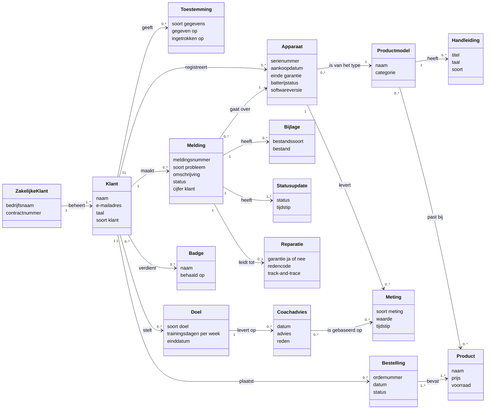

[← Terug naar de inhoudsopgave](README.md)

# 8. Domeinmodel

Het domeinmodel laat zien welke gegevens de app gebruikt en hoe ze met elkaar samenhangen. Een klasse is een soort gegeven, bijvoorbeeld een klant of een apparaat. De velden zijn de belangrijkste gegevens van die klasse. De lijnen zijn de relaties. "1" en "0..*" geven aan hoeveel er bij elkaar horen: één klant heeft nul of meer apparaten.

*Figuur 8.1. Het domeinmodel van de app.*

## 8.1 Toelichting

| Klasse | Wat het is | Belangrijkste gegevens | Waar het staat |
|---|---|---|---|
| Klant | Een particuliere klant met een account in de app | Naam, e-mailadres, taal, soort klant | Odoo (CRM) |
| ZakelijkeKlant | Een bedrijf dat wearables voor zijn medewerkers koopt | Bedrijfsnaam, contractnummer | Odoo (CRM) |
| Toestemming | De keuze van de klant per soort gegevens (zie story 2) | Soort gegevens, datum gegeven, datum ingetrokken | App |
| Apparaat | Een geregistreerde wearable van de klant | Serienummer, aankoopdatum, einde garantie, batterij, softwareversie | Odoo, aangevuld door de app |
| Productmodel | Het type wearable, bijvoorbeeld de WMW One of de WMW Track | Naam, categorie | Odoo |
| Handleiding | Een handleiding, video of veelgestelde vraag bij een productmodel | Titel, taal, soort | App |
| Melding | Een vraag of probleem van de klant. In Odoo is dit een ticket | Meldingsnummer, soort probleem, omschrijving, status, cijfer | Odoo Helpdesk |
| Bijlage | Een foto of video bij een melding | Bestandssoort, bestand | Odoo Helpdesk |
| Statusupdate | Elke statuswijziging van een melding, voor de tijdlijn in de app | Status, tijdstip | Odoo Helpdesk |
| Reparatie | De reparatie die uit een melding volgt | Garantie ja of nee, redencode, track-and-trace | Odoo Reparaties |
| Doel | Het doel dat de klant met de AI-coach instelt | Soort doel, dagen per week, einddatum | App |
| Meting | Een gegeven van de wearable of een gezondheidsplatform, zoals stappen, hartslag of slaap | Soort meting, waarde, tijdstip | App, alleen met toestemming |
| Coachadvies | Het advies van de AI-coach voor een dag | Datum, advies, reden | App |
| Bestelling | Een bestelling van de klant in de app. In Odoo is dit een verkooporder | Ordernummer, datum, status | Odoo (Verkoop) |
| Product | Een accessoire, onderdeel of abonnement dat de klant kan bestellen | Naam, prijs, voorraad | Odoo (Voorraad) |
| Badge | Een beloning voor een behaald doel of een uitdaging | Naam, datum behaald | App |

De laatste kolom laat zien waar een gegeven wordt opgeslagen. Volgens ons architectuurprincipe uit 2.9 is Odoo de bron voor klant-, product-, order- en ticketgegevens. De app slaat alleen gegevens op die Odoo niet heeft, zoals metingen, doelen en adviezen van de AI-coach.
