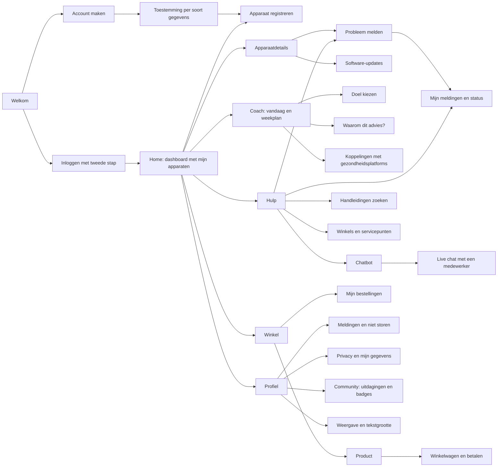

[← Terug naar de inhoudsopgave](../README.md)

# 9. Sitemap

De sitemap laat zien welke schermen de app heeft en hoe je van het ene naar het andere scherm gaat. Onderaan de app staat een vaste menubalk met vijf knoppen: Home, Coach, Hulp, Winkel en Profiel. Vanuit elk scherm kom je dus met één tik terug op een hoofdscherm.

*Figuur 9.1. De sitemap van de app.*

## 9.1 Toelichting

| Scherm | Wat de gebruiker hier doet | Bijbehorende user stories |
|---|---|---|
| Welkom, Inloggen, Account maken | Een account maken en veilig inloggen | 1 |
| Toestemming / Privacy en mijn gegevens | Per soort gegevens toestemming geven of intrekken, gegevens downloaden of laten verwijderen | 2 |
| Apparaat registreren | De QR-code scannen of het serienummer invoeren | 3 |
| Home: dashboard | Alle apparaten zien met garantie, batterij en softwareversie | 4 |
| Apparaatdetails | De gegevens van één apparaat, met een knop om een probleem te melden | 4, 5 |
| Software-updates | Zien welke update er is en wat er verandert | 15 |
| Coach | Het advies van vandaag en het weekplan zien | 9, 13 |
| Doel kiezen | Een doel kiezen en aangeven hoeveel dagen per week je kunt trainen | 9 |
| Waarom dit advies? | Zien op welke gegevens het advies gebaseerd is | 9 |
| Koppelingen | Apple Gezondheid, Google Health Connect of Strava koppelen | 14 |
| Hulp | Startpunt voor alle hulp | 8, 11, 12 |
| Chatbot / Live chat | Vragen stellen aan de chatbot, en zo nodig doorgaan met een medewerker | 8, 11 |
| Handleidingen zoeken | Zoeken in de handleidingen van je eigen apparaat | 12 |
| Probleem melden | Een probleem melden met foto's of een video | 5, 20 |
| Mijn meldingen en status | De tijdlijn van een melding volgen en een cijfer geven | 7 |
| Winkels en servicepunten | Het dichtstbijzijnde servicepunt op een kaart zien | 24 |
| Winkel, Product, Winkelwagen | Accessoires en onderdelen bestellen die passen bij je apparaat | 16, 21 |
| Mijn bestellingen | De status van je bestellingen zien | 16 |
| Meldingen en niet storen | Per onderwerp kiezen welke pushberichten je krijgt | 17 |
| Community | Meedoen aan uitdagingen, badges zien en stemmen op ideeën | 22, 23 |
| Weergave en tekstgrootte | Contrast en tekstgrootte aanpassen | 10 |
