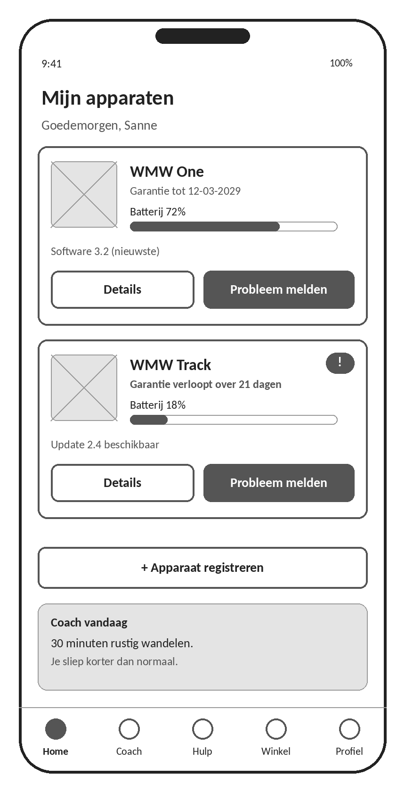
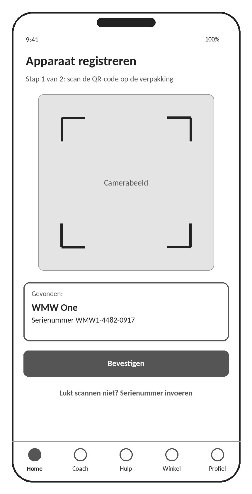
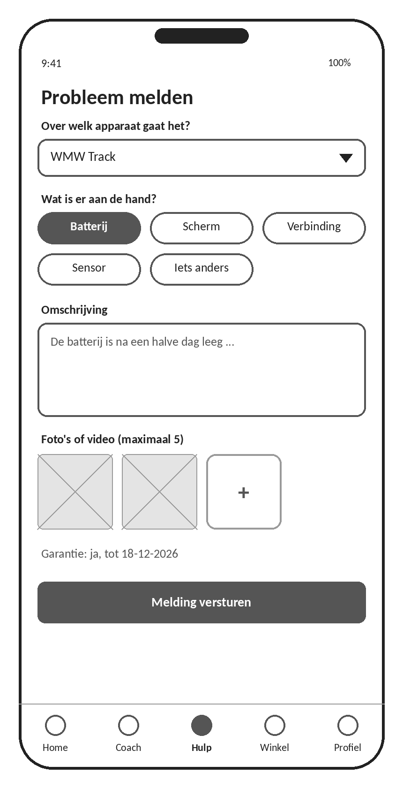
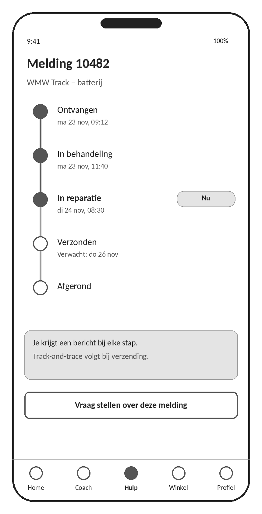
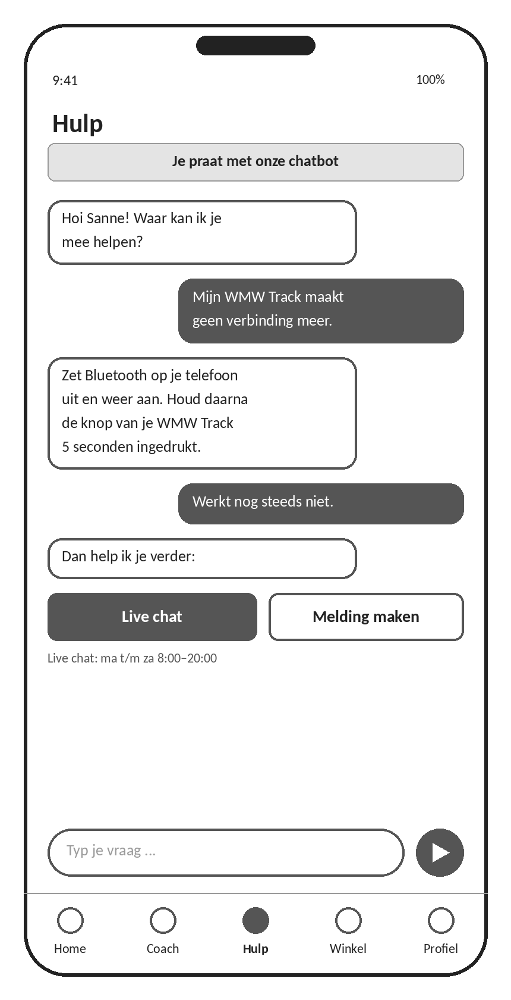
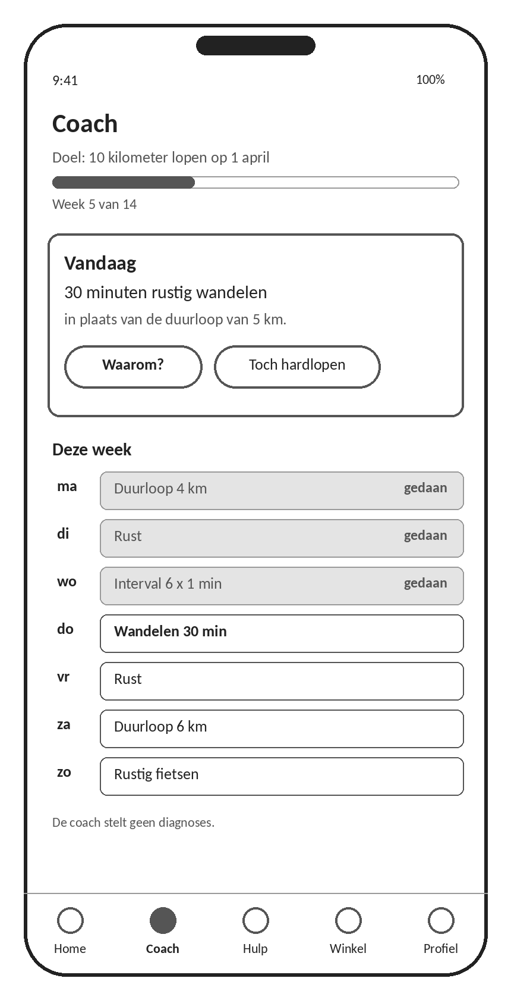

[← Terug naar de inhoudsopgave](README.md)

# 10. Wireframes

Een wireframe is een simpele schets van een scherm, zonder kleuren of huisstijl. Het laat zien wat er op het scherm staat en waar. Wij hebben wireframes gemaakt voor zes stories uit het MVP. Ze volgen samen de route van een klant: hij registreert zijn apparaat, ziet het op zijn dashboard, meldt een probleem, volgt de status, krijgt hulp van de chatbot en gebruikt de AI-coach. De namen en gegevens op de schermen zijn voorbeelden.

## 10.1 Dashboard met mijn apparaten (user story 4)

*Figuur 10.1. Het startscherm met de apparaten van de klant.*

| | |
|---|---|
| **User story** | Als klant wil ik op een dashboard al mijn apparaten zien met garantie, batterij en softwareversie, zodat ik weet hoe mijn apparaat ervoor staat. |
| **Wat je op het scherm ziet** | Per apparaat een kaart met de naam, de garantie, de batterij en de softwareversie. Daaronder twee knoppen: details en probleem melden. Onder de apparaten staan een knop om een nieuw apparaat te registreren en het advies van de coach voor vandaag. Onderaan staat de vaste menubalk. |
| **Hoe het de acceptatiecriteria laat zien** | Alle vier de gegevens uit de criteria staan op de kaart. Bij de WMW Track verloopt de garantie binnen 30 dagen, dus staat er een uitroepteken en is de tekst vetgedrukt. De knop "Probleem melden" staat bij elk apparaat, zodat de klant met één tik een melding kan maken. |

---

## 10.2 Apparaat registreren met een QR-code (user story 3)

*Figuur 10.2. Een apparaat registreren door de QR-code te scannen.*

| | |
|---|---|
| **User story** | Als klant wil ik mijn wearable registreren door de QR-code op de verpakking te scannen, zodat ik geen serienummer hoef over te typen. |
| **Wat je op het scherm ziet** | Bovenaan het camerabeeld met een kader voor de QR-code. Na het scannen staan het model en het serienummer eronder, met een knop om te bevestigen. Onderaan staat een link om het serienummer met de hand in te voeren. |
| **Hoe het de acceptatiecriteria laat zien** | De app toont het model en het serienummer en vraagt om te bevestigen. De link onderaan is de route als de camera niet werkt. In stap 2 haalt de app de aankoopdatum en de garantie uit Odoo. |

---

## 10.3 Probleem melden (user story 5)

*Figuur 10.3. Een probleem melden met foto's.*

| | |
|---|---|
| **User story** | Als klant wil ik een probleem melden met foto's of een video, zodat de klantenservice meteen ziet wat er mis is. |
| **Wat je op het scherm ziet** | De klant kiest het apparaat en tikt op een soort probleem. Daaronder vult hij een omschrijving in en voegt hij foto's of een video toe. De app laat zien of er nog garantie is. Onderaan staat de knop om de melding te versturen. |
| **Hoe het de acceptatiecriteria laat zien** | De soorten problemen zijn dezelfde als de redencodes in Odoo. Er passen maximaal vijf foto's bij. De klant hoeft geen gegevens of aankoopbewijs in te vullen, want de app kent zijn apparaat al. |

---

## 10.4 Status van mijn melding volgen (user story 7)

*Figuur 10.4. De tijdlijn van een melding.*

| | |
|---|---|
| **User story** | Als klant wil ik de status van mijn melding of reparatie volgen, zodat ik niet hoef te bellen om te vragen hoe ver het is. |
| **Wat je op het scherm ziet** | Een tijdlijn met vijf stappen. De stappen die klaar zijn, zijn gevuld, met de datum en de tijd. De huidige stap is gemarkeerd met "Nu". Bij de volgende stap staat wanneer die verwacht wordt. Onderaan kan de klant een vraag stellen over deze melding. |
| **Hoe het de acceptatiecriteria laat zien** | Alle stappen uit de criteria staan in de tijdlijn. Onder de tijdlijn staat dat de klant bij elke stap een bericht krijgt en dat de track-and-trace-code volgt bij verzending. Na de stap "Afgerond" verschijnt de vraag om een cijfer. |

---

## 10.5 Chatbot en live chat (user story 8 en 11)

*Figuur 10.5. Een gesprek met de chatbot, met de keuze voor een live chat.*

| | |
|---|---|
| **User story** | Als klant wil ik dag en nacht vragen stellen aan een chatbot, zodat ik niet hoef te wachten tot de klantenservice open is. |
| **Wat je op het scherm ziet** | Bovenaan staat dat de klant met een chatbot praat. Daaronder het gesprek. De chatbot noemt het apparaat van de klant bij naam. Als het probleem niet is opgelost, biedt de chatbot een live chat of een melding aan, met de openingstijden van de live chat erbij. |
| **Hoe het de acceptatiecriteria laat zien** | De regel bovenaan voldoet aan de AI Act: de klant weet dat het geen mens is. De chatbot gebruikt de gegevens van de klant (zijn WMW Track). Weet hij het niet, dan geeft hij het gesprek door. |

---

## 10.6 Weekplan van de AI-coach (user story 9)

*Figuur 10.6. Het scherm van de AI-coach met het advies van vandaag en het weekplan.*

| | |
|---|---|
| **User story** | Als klant wil ik een weekplan van de AI-coach op basis van mijn doel en mijn gegevens, zodat ik gericht aan mijn doel kan werken. |
| **Wat je op het scherm ziet** | Bovenaan het doel van de klant en hoe ver hij is. Daaronder het advies voor vandaag, met de knoppen "Waarom?" en "Toch hardlopen". Daaronder het weekplan, met per dag een activiteit. Dagen die klaar zijn, zijn grijs. Onderaan staat dat de coach geen diagnoses stelt. |
| **Hoe het de acceptatiecriteria laat zien** | Het weekplan heeft per dag een activiteit en het advies staat in gewone taal. Met "Waarom?" ziet de klant op welke gegevens het advies gebaseerd is. Het advies van vandaag is aangepast omdat de klant slecht sliep. Dat hoort bij story 13, en met "Toch hardlopen" kan de klant het oude plan kiezen. |
